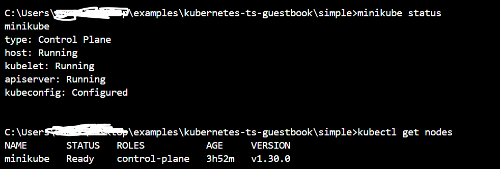
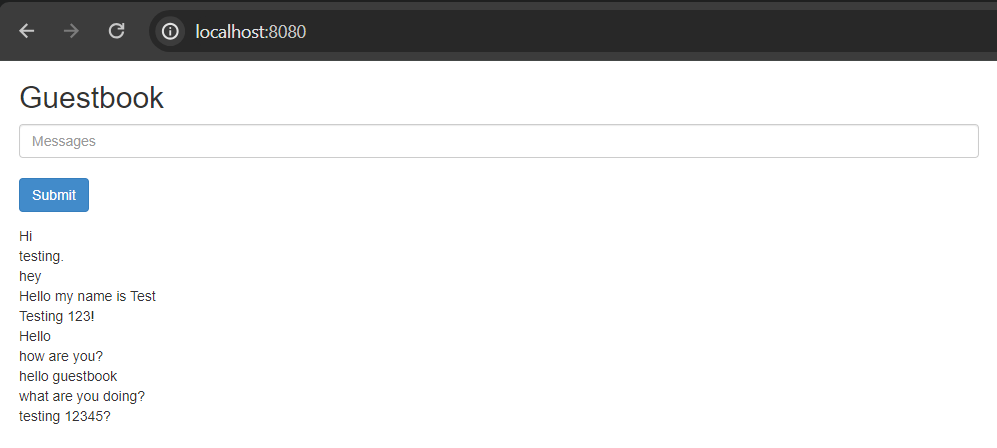
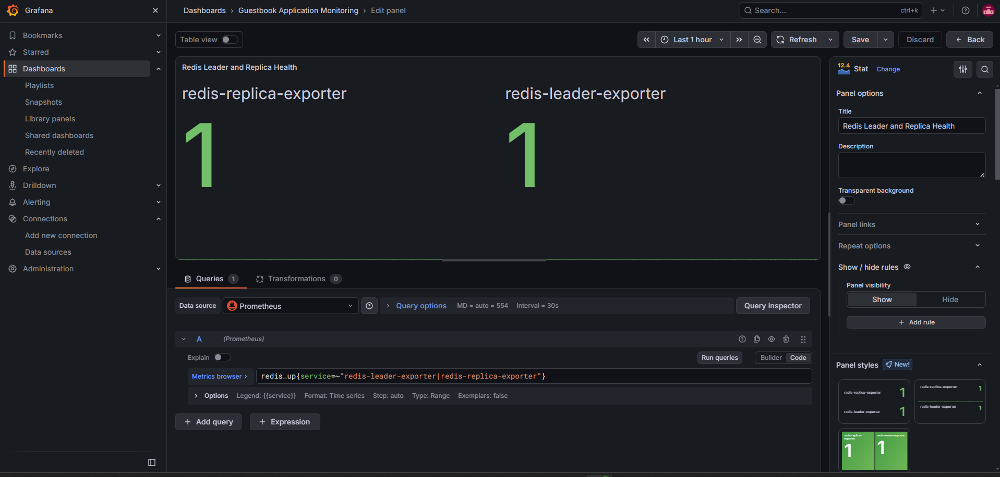
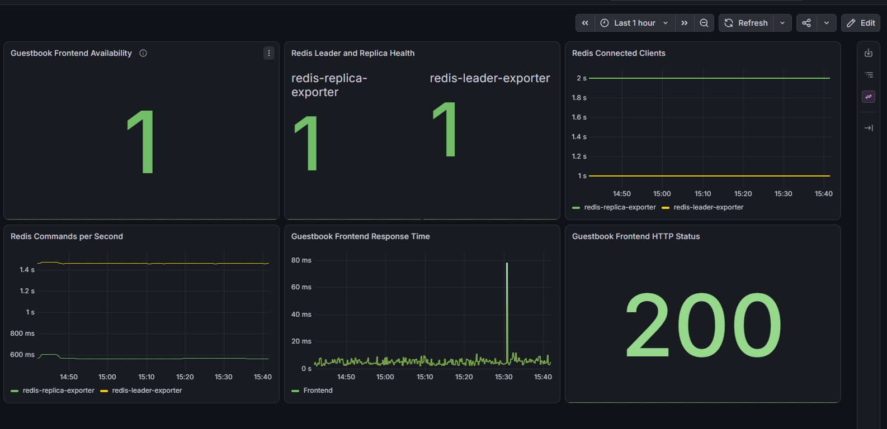
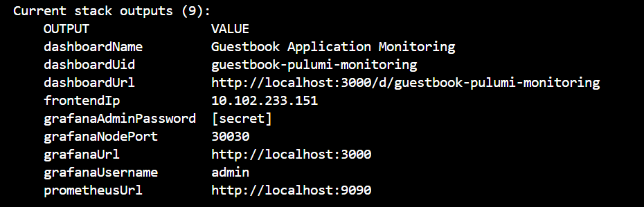

# Guestbook Application Monitoring with Pulumi, Prometheus and Grafana

## What I did

I extended the existing [Pulumi Kubernetes TypeScript Guestbook example](https://github.com/pulumi/examples/tree/master/kubernetes-ts-guestbook/simple) by deploying Prometheus and Grafana with Pulumi. I added monitoring for the Redis backend and the Guestbook frontend, then created a six-panel Grafana dashboard and automated its deployment through Pulumi.

I used **Windows PowerShell, Docker Desktop, Minikube, Kubernetes, Pulumi, TypeScript, Helm, Prometheus and Grafana**.

## Step 1 — Install the required tools

I installed and started Docker Desktop and installed:

- Git
- Node.js and npm
- Visual Studio Code
- Minikube
- kubectl
- Pulumi CLI
- Helm

I checked the installations in PowerShell:

```powershell
docker --version
node --version
npm --version
git --version
minikube version
kubectl version --client
pulumi version
helm version
```

## Step 2 — Start Minikube

I started a local Kubernetes cluster with Docker as the driver:

```powershell
minikube start --driver=docker --cpus=4 --memory=6144
```

I confirmed the cluster was running:

```powershell
minikube status
kubectl get nodes
```

The Minikube node showed **Ready**.

**Screenshot (optional): Minikube running successfully**



## Step 3 — Download the existing Guestbook application

I cloned the official Pulumi examples repository and opened its TypeScript Guestbook `simple` project:

```powershell
cd $HOME\Desktop
git clone https://github.com/pulumi/examples.git
cd examples\kubernetes-ts-guestbook\simple
code .
npm install
```

I worked inside the `simple` folder throughout the assignment.

## Step 4 — Deploy the Guestbook with Pulumi

I signed in to Pulumi and initialized my development stack:

```powershell
pulumi login
pulumi stack init dev
pulumi config set isMinikube true
pulumi up
```

I selected **yes** when Pulumi asked for deployment confirmation.

I checked the pods and services:

```powershell
kubectl get pods
kubectl get svc
```

The application had three frontend pods, one Redis leader pod and one Redis replica pod running.

**Screenshot (optional): Kubernetes pods running**

.png)
.png)

I opened the Guestbook using port forwarding:

```powershell
kubectl port-forward svc/frontend 8080:80
```

I visited **http://localhost:8080** and tested adding messages. The port-forward terminal must remain open while accessing the application.

**Screenshot (optional): Guestbook application running**



## Step 5 — Make the Redis versions compatible

I checked the Redis leader and replica versions using their actual pod names from `kubectl get pods`:

```powershell
kubectl exec <REDIS-LEADER-POD> -- redis-server --version
kubectl exec <REDIS-REPLICA-POD> -- redis-server --version
```

In `index.ts`, I pinned the Redis leader image to the version compatible with the Guestbook replica:

```typescript
image: "redis:6.0.5",
```

I applied the change:

```powershell
pulumi up
```

I checked replication:

```powershell
kubectl exec <REDIS-REPLICA-POD> -- redis-cli info replication
```

I confirmed `master_link_status:up` and tested that Guestbook entries remained after refreshing the page. (Replace the placeholder with the current pod name from `kubectl get pods`.)

## Step 6 — Create the monitoring namespace

I created a file named `monitoring.ts` in the `simple` folder. I added Pulumi Kubernetes code to create a namespace named `monitoring`, and imported that file from `index.ts`:

```typescript
import "./monitoring";
```

I deployed the change and verified the namespace:

```powershell
pulumi up
kubectl get namespaces
```

The `monitoring` namespace showed **Active**.

## Step 7 — Deploy Prometheus and Grafana

In `monitoring.ts`, I used Pulumi's Kubernetes Helm `Release` resource with the **kube-prometheus-stack** chart. The Helm configuration installed Prometheus, Grafana and the Prometheus Operator in the `monitoring` namespace. I disabled Alertmanager for this local demonstration, configured resource requests and limits, and exposed Grafana through a NodePort service on port **30030**.

I set the Grafana administrator password as an encrypted Pulumi configuration secret:

```powershell
pulumi config set --secret grafanaAdminPassword "YOUR_STRONG_PASSWORD"
```

`YOUR_STRONG_PASSWORD` is a placeholder; I did not put the real password into the project files or README.

I deployed and checked the monitoring resources:

```powershell
pulumi up
kubectl get pods -n monitoring
kubectl get svc -n monitoring
```

I opened Grafana through port forwarding:

```powershell
kubectl port-forward -n monitoring svc/monitoring-grafana 3000:80
```

- **Grafana URL:** http://localhost:3000
- **Username:** `admin`
- **Password:** The value configured as the Pulumi secret

I confirmed Grafana's Prometheus data source was working by opening **Explore**, querying `up` and seeing successful targets.


## Step 8 — Monitor the Redis backend

I extended `monitoring.ts` to deploy two Redis exporters:

- `redis-leader-exporter`
- `redis-replica-exporter`

I created Kubernetes Services for their `/metrics` endpoints on port **9121** and `ServiceMonitor` resources so Prometheus would scrape them every **15 seconds**.

I deployed the changes:

```powershell
pulumi up
kubectl get pods
kubectl get servicemonitors -A
```

In Grafana Explore, I tested:

```promql
redis_up
```

Both exporters returned a value of **1**. I also tested:

```promql
redis_connected_clients
rate(redis_commands_processed_total[5m])
```

**Screenshot (optional): Prometheus collecting Redis metrics**



## Step 9 — Monitor the Guestbook frontend

I added a Prometheus Blackbox Exporter Deployment and Service to `monitoring.ts`, along with a `Probe` resource that checks the Guestbook frontend every **15 seconds**.

I deployed the changes:

```powershell
pulumi up
kubectl get pods
kubectl get probes -A
```

I confirmed the frontend metrics in Grafana Explore:

```promql
probe_success{job="guestbook-frontend"}
probe_http_status_code{job="guestbook-frontend"}
probe_duration_seconds{job="guestbook-frontend"}
```

The availability check returned **1**, and the frontend HTTP status returned **200**. The duration query returned response-time measurements in seconds.


## Step 10 — Create the Grafana dashboard

In Grafana, I opened **Dashboards → New dashboard** and added six panels using Prometheus as the data source:

| Panel | PromQL query | Visualization |
|---|---|---|
| Guestbook Frontend Availability | `probe_success{job="guestbook-frontend"}` | Stat |
| Redis Leader and Replica Health | `redis_up{service=~"redis-leader-exporter\|redis-replica-exporter"}` | Stat |
| Redis Connected Clients | `redis_connected_clients{service=~"redis-leader-exporter\|redis-replica-exporter"}` | Time series |
| Redis Commands per Second | `rate(redis_commands_processed_total{service=~"redis-leader-exporter\|redis-replica-exporter"}[5m])` | Time series |
| Guestbook Frontend Response Time | `probe_duration_seconds{job="guestbook-frontend"}` | Time series |
| Guestbook Frontend HTTP Status | `probe_http_status_code{job="guestbook-frontend"}` | Stat |

For Redis panels, I used `{{service}}` as the legend to distinguish the leader and replica. For the Redis health Stat panel, I selected **Calculate → Last (not null)** to show one current value per instance.

I saved the dashboard as **Guestbook Application Monitoring**.

**Screenshot (optional): Completed six-panel Grafana dashboard**



## Step 11 — Automate the dashboard with Pulumi

I exported the Grafana dashboard to `guestbook-dashboard.json` and saved it in the `simple` project folder.

I created a new TypeScript file, `dashboard.ts`, to read that JSON file and create a Kubernetes ConfigMap labeled `grafana_dashboard: "1"`. In `monitoring.ts`, I enabled Grafana's dashboard sidecar so it discovers dashboard ConfigMaps.

I added this import to `index.ts`:

```typescript
import "./dashboard";
```

I then ran:

```powershell
pulumi preview
pulumi up
kubectl get configmap guestbook-grafana-dashboard -n monitoring
```

I confirmed Grafana automatically loaded the six-panel dashboard at:

**http://localhost:3000/d/guestbook-pulumi-monitoring**

This means the dashboard can be recreated from the Pulumi code and JSON rather than being built manually each time.


## Step 12 — Export access details from Pulumi

In `index.ts`, I exported the Grafana and dashboard outputs from `monitoring.ts` and `dashboard.ts`. I applied the changes and verified them:

```powershell
pulumi up
pulumi stack output
```

The outputs included:

| Output | Value |
|---|---|
| `grafanaUrl` | `http://localhost:3000` |
| `grafanaNodePort` | `30030` |
| `grafanaUsername` | `admin` |
| `grafanaAdminPassword` | `[secret]` |
| `prometheusUrl` | `http://localhost:9090` |
| `dashboardName` | `Guestbook Application Monitoring` |
| `dashboardUid` | `guestbook-pulumi-monitoring` |
| `dashboardUrl` | `http://localhost:3000/d/guestbook-pulumi-monitoring` |

The password can be retrieved locally with:

```powershell
pulumi stack output grafanaAdminPassword --show-secrets
```

**The password must not be published in screenshots, a public repository or the submitted ZIP.** The localhost URLs require the relevant `kubectl port-forward` command on the machine running Minikube.

**Screenshot (optional): Pulumi stack outputs (with password hidden)**



## Step 13 — Final verification

I used these commands to confirm the application and monitoring resources:

```powershell
kubectl get nodes
kubectl get pods
kubectl get pods -n monitoring
kubectl get svc -n monitoring
kubectl get servicemonitors,probes -A
pulumi stack output
```

For direct access to Prometheus, I used a separate terminal:

```powershell
kubectl port-forward -n monitoring svc/monitoring-prometheus 9090:9090
```

Prometheus is then available at **http://localhost:9090**. I verified Redis and frontend metrics in Grafana Explore and could also inspect scrape targets in Prometheus under **Status → Target health / Targets**.

## Project files for submission

```text
simple/
├── index.ts
├── monitoring.ts
├── dashboard.ts
├── guestbook-dashboard.json
├── package.json
├── package-lock.json
├── Pulumi.yaml
├── tsconfig.json
└── README.md
```

The source files, dashboard JSON, README and `screenshots` folder are included in the ZIP. The six screenshot links above will display once the matching PNG files are saved inside `simple/screenshots/`. The `node_modules` directory, `.git` directory, local state, and files containing credentials should not be included. Anyone reviewing the code can run `npm install`, configure a fresh Pulumi stack and password, and run `pulumi up` to recreate the deployment.

## Troubleshooting: Common problems and fixes

| Problem | Likely cause | What to do |
|---|---|---|
| `Docker Desktop has only 7781MB memory but you specified 8192MB` | Requested more RAM than Docker has available | Start Minikube with `minikube start --driver=docker --cpus=4 --memory=6144`; reduce further if required. |
| `kubectl get nodes` doesn't show `Ready` | Minikube is still starting or Docker is unavailable | Check `minikube status`, ensure Docker Desktop is running, and retry after startup. |
| `deployments.apps "redis-leader" not found` | The resource may not be a Deployment with that name | Run `kubectl get pods` and use `kubectl exec <POD-NAME> -- ...` with the current Redis pod name. |
| Guestbook messages disappear after refresh | The Redis replica is not receiving data from the leader | Run `redis-cli info replication` inside the replica and inspect `master_link_status`. |
| `Can't handle RDB format version 15` | Redis leader and replica versions are incompatible | Pin the Redis leader image to `redis:6.0.5` in `index.ts` to match this example's replica, then run `pulumi up`. |
| `master_link_status:down` | Replication has failed | Inspect `kubectl logs <REDIS-REPLICA-POD> --tail=30`, compare Redis versions and check `kubectl get endpoints redis-leader`. |
| Both Redis pods respond `PONG`, but messages still disappear | Redis is running, but replication may still be broken | Check `redis-cli info replication`; `PONG` alone does not prove replication works. |
| Text containing a comma appears as separate Guestbook entries | Formatting behavior of the demonstration frontend | This is separate from monitoring; use simple messages to test persistence and review the frontend code if exact formatting is required. |
| Grafana doesn't open at localhost:3000 | Port-forward isn't running or Grafana isn't ready | Run `kubectl get pods -n monitoring` and `kubectl port-forward -n monitoring svc/monitoring-grafana 3000:80` in a terminal that stays open. |
| Grafana's `up` query works but `redis_up` is empty | Redis ServiceMonitors/exporters aren't being scraped | Check exporter pods and `kubectl get servicemonitors -A`; inspect targets in Prometheus. |
| `redis_up` is `0` | Exporter cannot contact Redis | Check Redis Services, exporter environment settings and exporter pod logs. |
| `probe_success` is `0` or has no data | Frontend is unreachable, or Prometheus has not discovered the Probe | Check `kubectl get probes -A`, the blackbox pod, the frontend Service, and Prometheus targets. |
| Stat visualization shows many repeated `1` values | Grafana is set to **All values** | Change **Value options → Show** to **Calculate**, then select **Last (not null)**. |
| A healthy HTTP `200` appears red | Grafana's default threshold colors don't match HTTP semantics | Set absolute thresholds: base red, `200` green, `300` red. |
| A time-series graph is empty over most of the last six hours | Monitoring only began recently | Change the dashboard time range to **Last 30 minutes** or **Last 1 hour**. |
| Grafana dashboard not found after Pulumi creates the ConfigMap | Dashboard sidecar hasn't discovered it or configuration is incorrect | Verify `grafana_dashboard: "1"`, sidecar settings, namespace search settings, and the ConfigMap in `monitoring`. |
| Pulumi outputs show only `frontendIp` | Monitoring/dashboard values weren't re-exported from `index.ts` | Add the appropriate `export { ... } from "./monitoring"` and `export { ... } from "./dashboard"`, then run `pulumi up`. |
| Dashboard appears but shows **No data** after importing elsewhere | The exported dashboard may reference a different Prometheus data source UID | Select the correct Prometheus data source for the imported panels. |

## Clean up (when no longer needed)

```powershell
pulumi destroy
minikube stop
```

`pulumi destroy` deletes the Pulumi-managed resources, so run it only after finishing the demonstration and submission.
